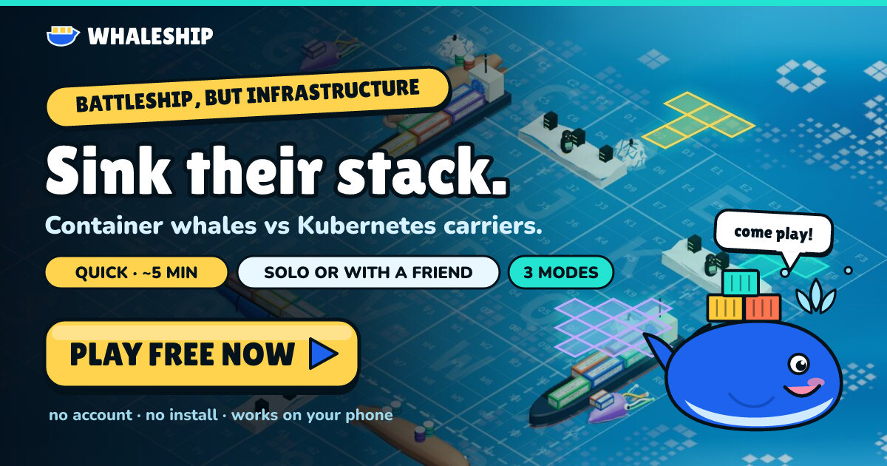
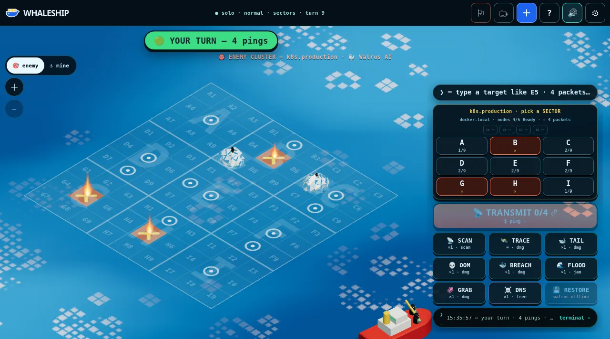
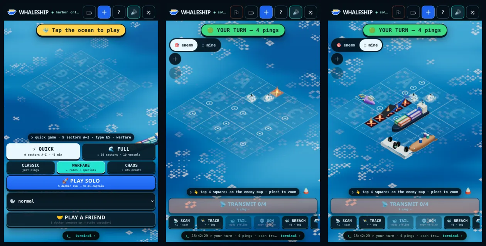

# 🐋 WHALESHIP

**▶ [Play now](https://go.fridge.run/whaleship/)** · [How to play](https://go.fridge.run/whaleship/how.html)

**Battleship where the ships are infrastructure.** Your fleet of container-carrying whales, Kubernetes carriers and Linux icebergs hides on a living 3D ocean. Ping, port-scan, tail-slap and packet-flood your way through the enemy's cluster until every node is `NotReady`.



- **Play in a browser** on a phone or desktop. No install, no account.
- **Solo** against three AI captains, or **send a friend a link** (or a QR code) and they're in.
- **Asynchronous**: no time limits, games persist across restarts, play several at once, and get **push notifications** (Web Push, even with the game closed) when it's your move.
- **Sign in once, play anywhere** (optional single sign-on): your games follow your account to your phone. Installable to the home screen.
- **Two boards**: **⚡ Quick** — 9 sectors (`A`–`I`), 5 vessels, about five minutes — or **🌊 Full** — 36 sectors (`A`–`Z`, `0`–`9`), 10 vessels. Every sector is a 3×3 keypad: type `E5 B3 ⏎` on a keyboard, or just tap the map on a phone.
- **Invite links that sell themselves**: every invite unfurls in Discord, iMessage, Slack, X… with who's challenging you, the board and mode, and a banner for that board × mode (`web/img/invite/`).
- **Fast endgames**: losing vessels costs at most one ping, and when your opponent is down to their last two vessels you get a +1 mop-up ping.
- **Updates never break a game in progress**: saved matches carry a schema version and keep the rules they started with; every deploy dry-runs the new build against the saved games first ([docs/UPDATING.md](docs/UPDATING.md)).
- **Infrastructure roles**: each vessel powers abilities. Sink their Docker host and they lose Tail Slap; sink their proxy and your scans stop being masked.
- **Specials with real shapes**: T-shaped Tail Slap, + Breach, L Tentacle Grab, diamond Packet Flood, sector Port Scan, Traceroute, OOM Kill, DNS Poison decoys and Restore from backup.
- **Chaos mode** adds Kubernetes events: self-healing replicas, `CrashLoopBackOff`, `ImagePullBackOff`, node drains, DNS failures and `OOMKilled`.
- **The terminal** narrates everything as Docker and Kubernetes output, and every container has a Docker-style name (`hopeful_hopper`). You can play from it too.
- **The ocean's foam is Conway's Game of Life**, running on the water's surface.

| Enemy waters | On a phone |
|---|---|
|  |  |

How to play: [read it online](https://go.fridge.run/whaleship/how.html), or see [`web/how.html`](web/how.html) (served in-game at `/whaleship/how.html`, linked from the **?** button).

## Run it

You need Node.js 22+.

```sh
npm ci --omit=dev
node server.js            # → http://localhost:8080/whaleship/
```

Or with Docker:

```sh
docker compose up -d --build   # → http://localhost:8080/whaleship/   (data in ./data)
```

Run the tests with `node --test test/*.test.mjs`. They start a throwaway server on a random port.

## Configuration

| Variable | Default | Meaning |
|---|---|---|
| `PORT` | `8080` | HTTP/WebSocket port |
| `DATA_DIR` | `/data` | where match files and `results.jsonl` (leaderboard) are kept |
| `WEB_ROOT` | `./web` | the static client |
| `ALLOWED_ORIGINS` | *(any)* | comma-separated origins allowed to open the WebSocket. Set this in production, e.g. `https://games.example.com` |
| `INVITE_BASE` | the page's own URL | base for invite links, e.g. `https://example.com/whaleship` |
| `LOGIN_URL` | *(off)* | shows a **Sign in** button: the game's path is appended, e.g. `https://example.com/login/?next=` |
| `VAPID_SUBJECT` | `https://github.com/whaleship` | contact URL/mailto sent to push services with Web Push requests (VAPID keys are generated into `DATA_DIR/vapid.json` on first start) |
| `MAX_ACTIVE` | `400` | cap on unfinished matches |
| `FORFEIT_AFTER` | `604800` | seconds of opponent silence before you can claim the win |
| `AUTH_BRIDGE`, `AUTH_SECRET`, `AUTH_COOKIE` | *(off)* | optional single sign-on: the server forwards the named cookie to `AUTH_BRIDGE` (with `X-Whaleship-Auth: AUTH_SECRET`) and expects `{sub, name}` back. Without it, players are guests identified by a random cookie. |

The game is served under `/whaleship/`. Behind a reverse proxy, forward both HTTP and the WebSocket upgrade on `/whaleship/ws`.

## How it's built

```
server.js        one Node process: WebSocket protocol + static files + JSON-on-disk persistence
                 authoritative rules: fleets, salvoes, specials, roles, chaos events, AI captains
names.js         Docker-style container names (Moby's word lists), stable per match
web/index.html   the game page            web/how.html   how to play
web/src/app.js   client: state machine, targeting, HUD, terminal, effects overlay
web/src/ocean3d.js  Three.js world: orthographic isometric camera, ocean shader with
                    Game of Life foam, procedural low-poly creatures, packets, fire, splashes
web/src/creatures.js  2D fallback sprites (used when WebGL2 isn't available, or with ?2d)
web/src/audio.js  procedural Web Audio: surf, whale song, splashes, explosions, reverb
test/            node:test suite: rules, quick board, endgame pace, state transfer across updates
tools/deploy-fridge.sh  deploy with game-state transfer (snapshot → build → dry run → swap → verify)
web/img/         how-to screenshots, creature art, Open Graph banners (all rendered from the game)
```

There are no build steps and no frameworks. The server is the source of truth. The client only animates what the server says happened, and it never receives the positions of enemy vessels you haven't sunk.

## Credits

WHALESHIP is an unofficial fan project, not affiliated with Docker, Kubernetes or the Linux Foundation. It bundles three.js and qrcode-generator (both MIT), and Docker's container-name word lists (Apache-2.0); see [`THIRD_PARTY_NOTICES.md`](THIRD_PARTY_NOTICES.md). All artwork is original and generated in code.

Licensed under the [MIT License](LICENSE).
